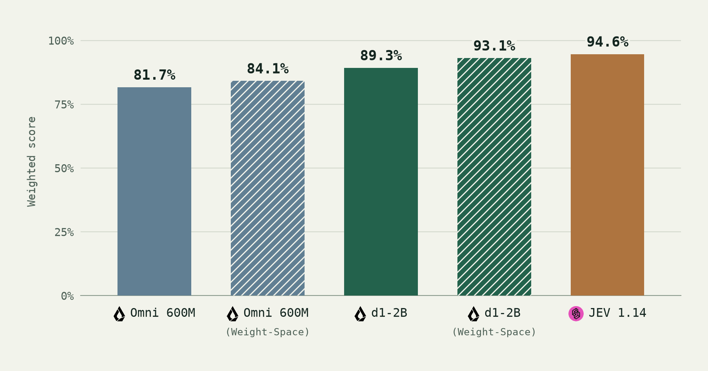

# Omni Mail

Omni Mail is a read-only Gmail inbox that labels incoming email **Action** or
**No Action**. A local Python app serves the React and TypeScript interface on
your Mac. **Sync mail** saves Gmail threads to a local SQLite database.
**Process** runs a decision model on the newest received inbox message in
each selected thread. You can read threads in Omni Mail and reply or manage
mail in Gmail.

Use Liquid AI's d1-2B or Omni 600M locally, or connect JEV through OpenRouter
or TypeSafe. Start with the stock model and check a few decisions yourself.
The optional lab shows how to use DSPy and WeightSpace to test a small
weight edit on your own labeled mail and load the resulting profile.

## Results on 400 emails

**JEV scored highest, and WeightSpace improved both local models.** Every
run used the same 400 emails, frozen shared prompt, and 0.50 cutoff.

| Model | Weighted score | Missed / 47 | False alerts / 353 | Penalty |
| --- | ---: | ---: | ---: | ---: |
| Omni 600M, stock | 81.7% | 26 | 30 | 82 |
| Omni 600M, WeightSpace | 84.1% | 22 | 27 | 71 |
| d1-2B, stock | 89.3% | 11 | 26 | 48 |
| d1-2B, WeightSpace (patch 20) | 93.1% | 7 | 17 | 31 |
| JEV 1.14, stock via OpenRouter | **94.6%** | 2 | 20 | **24** |

JEV caught **45 of 47** actions. Tuned d1-2B raised the fewest false
alerts. For the weighted score, subtract two points per missed action
and one per false alert from **447 possible points**. Divide what's left
by 447. **100%** means every label was correct.

These emails informed prompt development. An independent test would use
fresh mail. [How we ran the comparison](docs/experiment.md#shared-prompt-comparison)

## From inbox to a tuned profile

1. **[Install Omni Mail](docs/install.md#build-the-app).** Build the app and
   set up Python. You can [preview it with fictional mail](docs/install.md#try-the-sample-inbox).
2. **[Connect Gmail](docs/gmail.md#connect-gmail).** Grant read-only access
   in Google's consent screen and start the local server.
3. **[Download stock d1-2B](docs/models.md#set-up-local-inference).** Use
   it as your starting point for local triage.
4. **[Sync and process a few emails](docs/inbox.md#sync-and-process-mail).**
   Click **Sync mail**, select a few familiar threads, and use **Process
   selected**. Check both missed actions and false alerts.
5. **[Try JEV](docs/models.md#use-jev) (optional).** Add a provider key in
   **Settings** and [compare decisions on the same emails](docs/inbox.md#compare-stock-d1-2b-with-jev).
   Processing with JEV sends the selected message inputs to the provider.
6. **[Build a labeled dataset](omni-mail-lab/README.md#2-prepare-your-own-examples)
   (optional).** Review a small batch first, then collect more examples and
   keep related emails together when splitting the data.
7. **[Score stock and test the cutoff](omni-mail-lab/README.md#3-understand-what-each-notebook-does).**
   Review the baseline errors and use ReAnchor to see whether a different
   cutoff improves validation.
8. **[Try a WeightSpace edit](omni-mail-lab/README.md#4-enable-the-optional-weightspace-step).**
   Use Codex to propose a weight edit and decide whether to keep it on
   validation.
9. **[Compare and load your profile](omni-mail-lab/README.md#5-load-a-profile-in-omni-mail).**
   Freeze and export your chosen profile, score it against stock on your
   reserved emails, and try the profile in Omni Mail.

[Contributing and repository layout](CONTRIBUTING.md) · [License](LICENSE)
